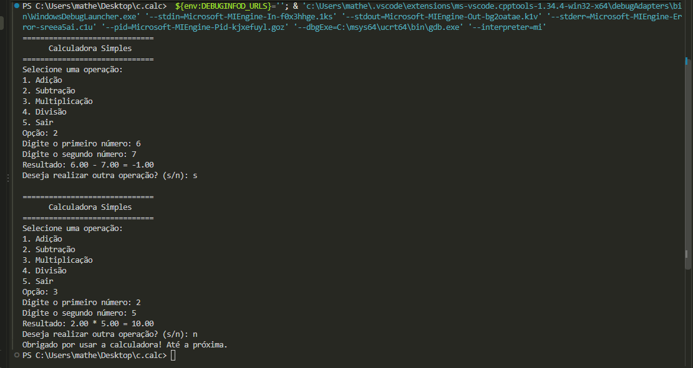

# Calculadora Simples em C

## 1. Título e descrição
A **Calculadora Simples** é um programa interativo desenvolvido em linguagem C que permite realizar operações aritméticas básicas (adição, subtração, multiplicação e divisão). O programa foi construído com validação avançada de dados de entrada, prevenindo erros de conversão, opções inválidas fora do intervalo permitido e tentativas de divisão por zero. É uma ferramenta útil para estudantes que estão a iniciar-se na programação em C e que procuram compreender o tratamento de entradas seguras no terminal.

## 2. Demonstração
Abaixo encontra-se uma representação visual do programa em execução:

## 3. Instalação e pré-requisitos
Para conseguir compilar e executar o programa no seu computador, certifique-se de que possui as seguintes ferramentas:
* Um compilador de C instalado e configurado no sistema (por exemplo, **GCC** ou Clang).
* Um terminal de comandos (PowerShell, CMD, Bash, etc.).

### Passos para preparação:
1. Descarregue ou clone os ficheiros do projeto para uma pasta local.
2. Certifique-se de que os ficheiros fonte (`main.c`), a licença (`LICENSE`) e a pasta de recursos (`assets/`) se encontram na raiz do diretório.

## 4. Uso e exemplos
Para compilar o código-fonte, abra o terminal na pasta do projeto e execute o comando do compilador GCC:

    gcc main.c -o calculadora

Para iniciar o programa, execute o binário gerado:
* **No Linux / macOS:** `./calculadora`
* **No Windows:** `.\calculadora.exe`

### Exemplo de execução passo a passo:
1. O menu principal será apresentado no terminal:

    ==============================
          Calculadora Simples      
    ==============================
    Selecione uma operação:
    1. Adição
    2. Subtração
    3. Multiplicação
    4. Divisão
    5. Sair
    Opção: 

2. Digite `1` para selecionar a Adição.
3. Insira o primeiro número quando solicitado (ex: `15.5`).
4. Insira o segundo número quando solicitado (ex: `4.5`).
5. O programa exibirá o resultado formatado:

    Resultado: 15.50 + 4.50 = 20.00

6. Poderá escolher continuar (`s`) para realizar novos cálculos ou terminar a sessão (`n`).

## 5. Estrutura do projeto
A organização dos ficheiros na raiz do repositório está disposta da seguinte forma:

    ├── README.md         # Documentação completa e instruções do projeto
    ├── LICENSE           # Texto completo da licença adotada
    ├── main.c            # Código-fonte principal da calculadora em C
    └── assets/           # Pasta para armazenamento de mídias do projeto
        └── demo.png      # Imagem de demonstração da execução

## 6. Licença
Este projeto encontra-se licenciado sob os termos da **Licença MIT**. Para mais informações detalhadas sobre os direitos e termos de utilização, consulte o ficheiro [LICENSE](./LICENSE) incluído na raiz.
